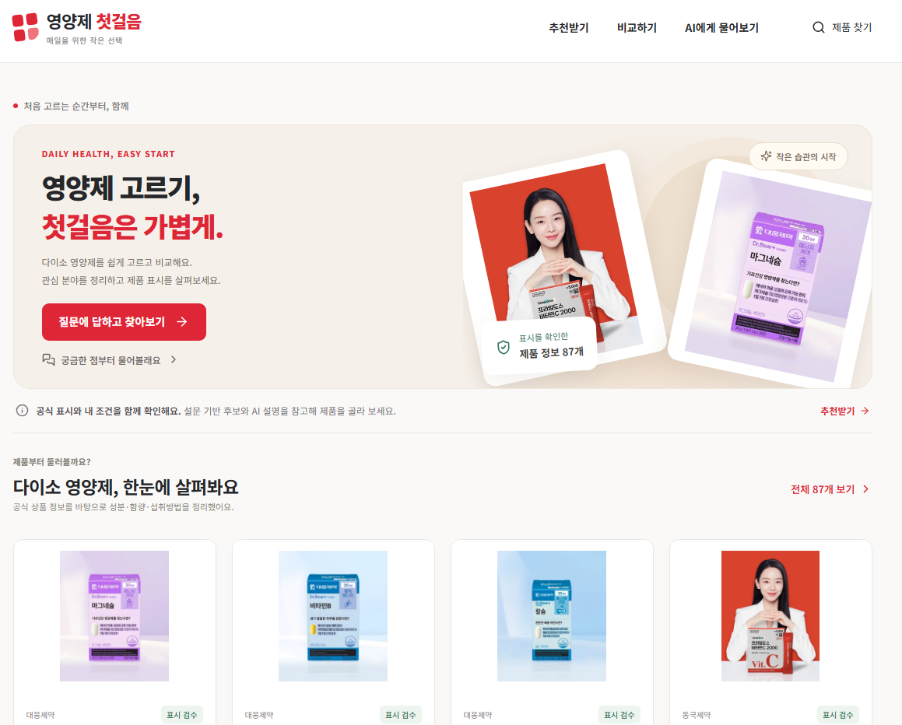
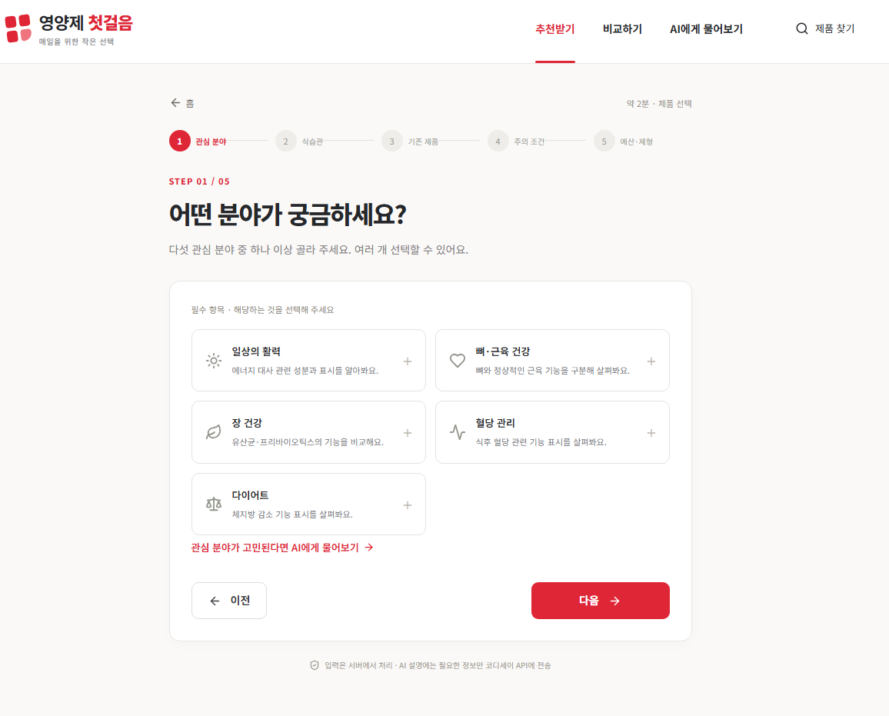
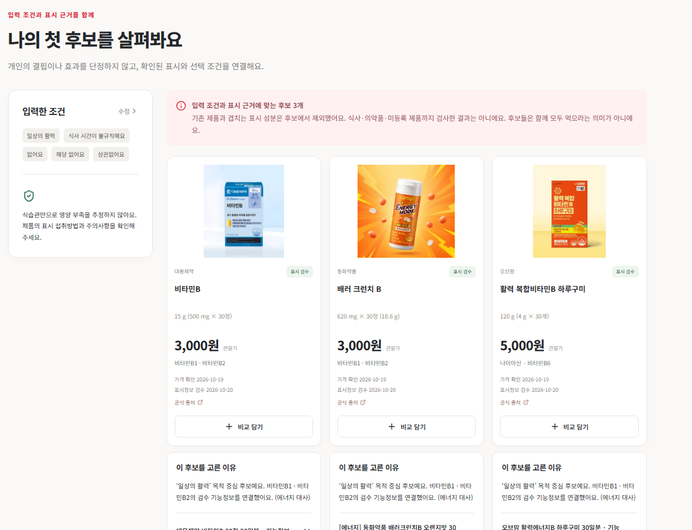
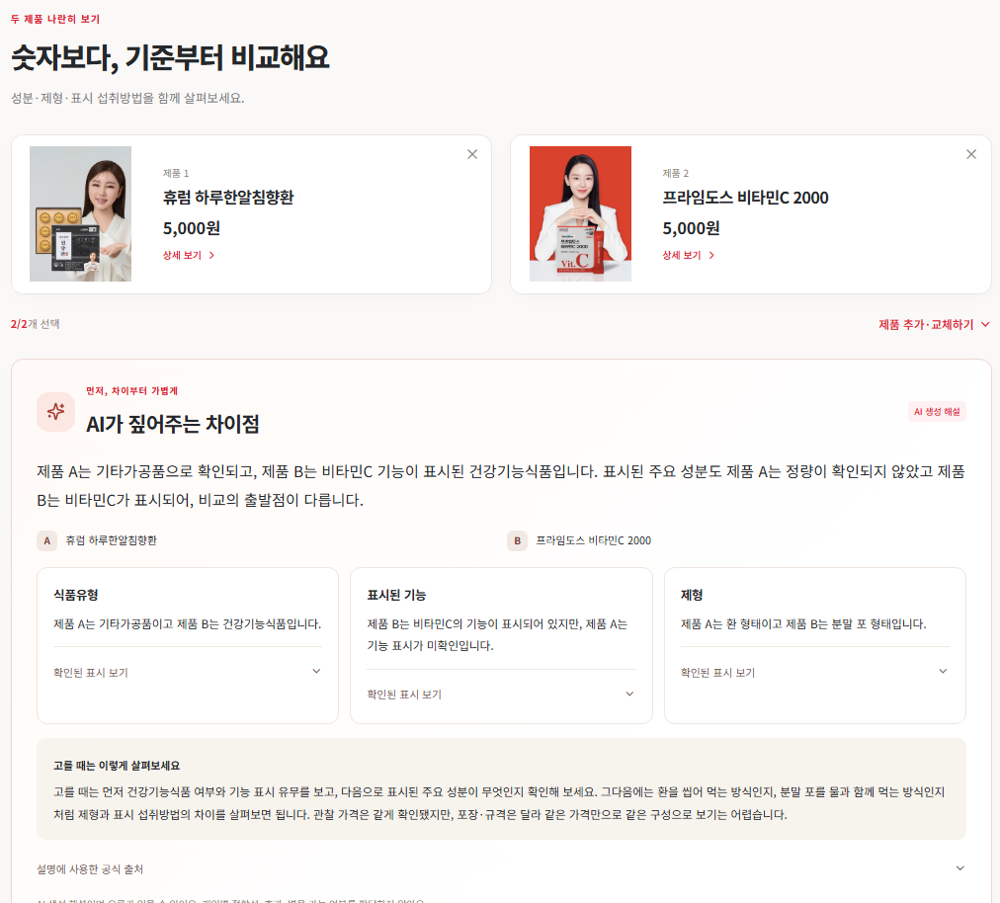
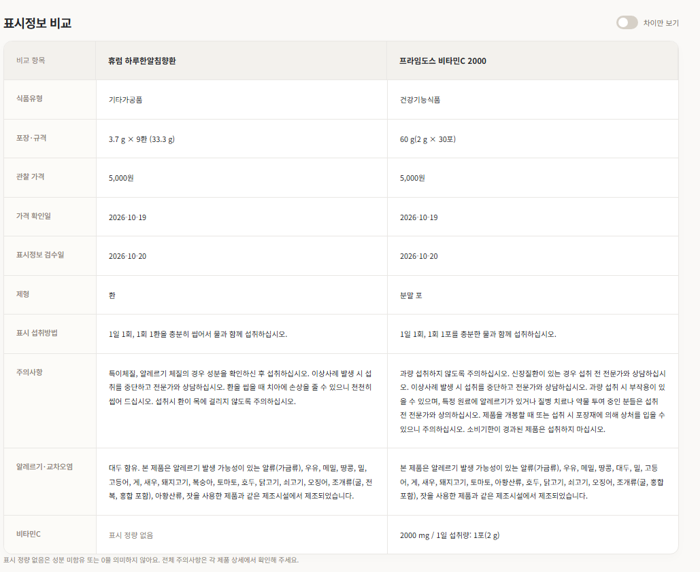
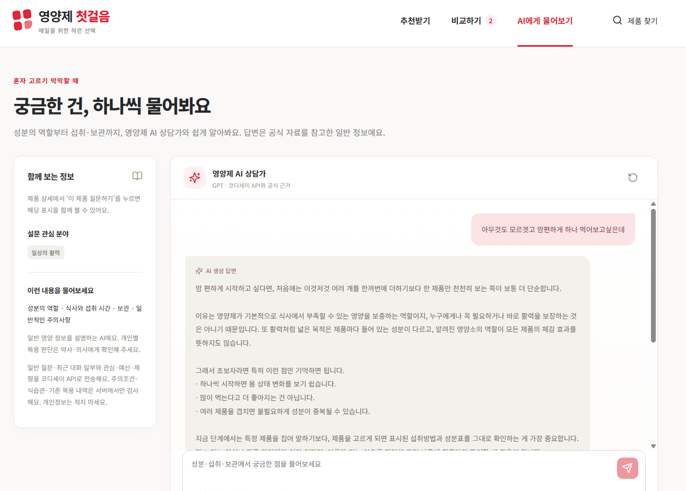

# 영양제 첫걸음

> 부담을 낮춘 첫 체험을 위해, 다이소 영양제를 찾고 제품 표시를 이해·비교하도록 돕는 성인 대상 웹 서비스.

[서비스 이용하기](https://vitastep-guide.onrender.com/) · [최종 제출 문서](https://github.com/sayknow/M2-1/blob/production/docs/final/README.md) · [기능 요구 명세서](https://github.com/sayknow/M2-1/blob/production/docs/functional-requirements.md)

영양제의 필요성을 느끼기 시작했지만 유명 제품의 가격이나 구매 경로가 부담스러운 성인을 위해 만들었습니다. 첫 체험의 범위를 가격과 구매 접근성을 고려한 다이소 제품으로 정하고, 여러 제품 중 무엇부터 살펴볼지와 표시를 어떻게 읽을지 돕습니다.

코디세이 교육 프로젝트이며 다이소의 공식·제휴 서비스가 아닙니다. 진단·처방·개인별 복용량 조절·병용 안전성 판단은 제공하지 않습니다.

## 이 저장소의 문서

- [기획서 검토·보완본](project-plan.md)
- [기능 요구 명세서 검토·보완본](functional-requirements.md)
- [작업 진행 기록·다른 컴퓨터에서 이어가기](WORKLOG.md)

이 저장소는 문서 검토·보완본과 화면 이미지를 공유하는 개인 저장소입니다. 아래 로컬 실행 안내와 구현·검증 기록은 [원본 프로젝트 sayknow/M2-1](https://github.com/sayknow/M2-1/tree/production)에 대한 내용입니다. 소스 코드와 최종 과제 제출 자료는 원본 저장소에서 관리합니다.

## 주요 기능

| 기능 | 할 수 있는 일 |
|---|---|
| 조건별 후보 탐색 | 관심 분야·기존 제품·주의조건·선택 예산·제형을 바탕으로 최대 3개 후보와 이유 확인 |
| 제품 찾기·상세 | 제품을 검색·필터링하고 관찰 가격·성분·함량·섭취 기준·주의·사진·출처 확인 |
| 두 제품 비교 | 두 제품의 표시정보를 나란히 보고 차이 확인. 필요하면 AI 비교 해설 이용 |
| AI 대화 | 영양 용어와 제품 표시를 질문하고 검색 근거·출처와 함께 설명 확인 |
| 기존 제품 중복 확인 | 등록 제품 사이의 같은 성분과 계산 가능한 하루 표시 합계 확인 |

관심 분야는 **일상의 활력·뼈·근육 건강·장 건강·혈당 관리·다이어트**입니다. 혈당 관리·다이어트에는 별도 범위 확인을 적용합니다. 후보는 함께 복용하라는 목록이 아니며, 조건에 따라 추천 제한·정보 부족·빈 결과를 안내합니다.

## 주요 화면

### 메인 — 서비스 소개와 제품 탐색

추천·비교·AI 대화·제품 찾기로 이동하고 공개 제품을 둘러볼 수 있습니다.



### 설문 — 관심 분야 선택

5단계 설문의 첫 단계에서 관심 분야를 하나 이상 선택합니다.



### 추천 결과 — 조건별 후보와 표시 근거

입력한 조건과 함께 최대 3개 후보의 관찰 가격·성분·출처·선정 이유를 확인합니다. 아래 화면은 일상의 활력을 선택한 예시입니다.



### 두 제품 비교 — 표시 차이와 AI 해설

선택한 두 제품의 가격·식품유형·제형 등 표시 차이를 살펴보고, AI 해설에서 주요 차이와 선택 시 확인할 기준을 읽을 수 있습니다.



<details>
<summary>상세 표시정보 비교표 보기</summary>

성분량·섭취방법·주의사항·관찰일을 같은 항목으로 비교합니다. 표시 정량이 없는 항목은 0으로 해석하지 않습니다.



</details>

<details>
<summary>AI 대화 화면 보기</summary>

직접 질문하고 일반 정보와 제품 표시를 이해하는 데 필요한 설명을 확인합니다. 아래 이미지는 대화 화면 예시이며 답변의 출처 영역까지는 포함하지 않습니다.



</details>

## 이용 방법

[운영 서비스](https://vitastep-guide.onrender.com/)에 접속합니다. 별도 가입이나 테스트 계정은 필요 없습니다. 원하는 목적에 따라 다음 경로를 이용합니다.

### 직접 제품을 찾아보고 싶다면

1. 제품 찾기에서 검색·필터로 관심 있는 제품을 찾습니다.
2. 상세 화면에서 가격·성분·섭취 기준·주의사항·출처를 확인합니다.
3. 차이가 궁금한 제품 두 개를 선택해 표시정보를 비교합니다.

제품 찾기·상세·표시 비교는 동의 없이 이용할 수 있습니다.

### 어떤 제품부터 살펴볼지 모르겠다면

1. 이용 안내를 확인하고 필요한 항목에 동의합니다.
2. 관심 → 식습관 → 기존 제품 → 주의조건 → 선택 예산·제형의 5단계 설문을 진행합니다.
3. 후보의 이유·성분·출처를 확인합니다. 필요하면 상세·비교·AI 대화로 이어서 살펴봅니다.

### 표시나 용어가 궁금하다면

이용 안내에 동의한 뒤 AI 대화에서 질문합니다. 특정 제품이 궁금하면 해당 제품 상세에서 AI 질문으로 이동합니다. 두 제품의 차이는 비교 화면의 AI 해설로 확인할 수 있습니다.

추천·AI 대화·AI 비교 해설에는 성인 이용·서비스 범위, 정보 처리·임시 보관, AI 생성·외부 전송 안내에 대한 동의가 필요합니다. 동의 철회 시 입력·대화·임시 연결을 초기화합니다.

첫 연결이 지연되면 서버 준비 안내를 확인해 주세요. 서버 준비와 AI 생성·실패 상태는 구분해 표시합니다.

## 데이터와 AI 동작

- **제품 데이터:** 수집 88개 중 검수한 87개를 공개하고 보류 1개는 제외합니다. 가격·표시는 주로 2026-10-19 관찰 자료이며 실시간 가격·재고 정보가 아닙니다. 제품별 출처와 관찰일을 함께 확인할 수 있습니다.
- **후보 선정:** 서버 규칙이 표시정보·목적 분류·기존 제품·주의조건·예산·제형으로 후보를 정합니다. AI가 임의로 후보를 선정하지 않습니다.
- **AI 설명:** 코디세이 COPA를 통해 GPT-5.4를 사용합니다. Agent가 질문에 필요한 도구를 선택하고 SQLite 제품 자료와 공식 지식을 검색해 답변과 출처를 제공합니다(RAG).
- **정보 처리:** 가입 계정과 사용자 장기 메모리는 사용하지 않습니다. 서비스 서버는 건강 입력·대화 원문을 영구 저장하지 않고 임시 메모리로 처리합니다. 외부 AI 제공자의 처리 범위는 [보안·운영 문서](https://github.com/sayknow/M2-1/blob/production/docs/final/security-and-operations.md)를 참고하세요.

## 기술 구성

| 영역 | 구성 |
|---|---|
| 프런트엔드 | React · TypeScript · Vite |
| 백엔드 | Python · FastAPI · Pydantic |
| 데이터 | 읽기 전용 SQLite · 분류/지식 JSON |
| AI | OpenAI Python SDK · COPA · GPT-5.4 |
| 배포·품질 | Render 정적 사이트·Docker API · GitHub Actions |

```text
frontend/     화면과 API 연결
backend/      API·동의·후보 정책·Agent·표시 비교
data/         제품·분류·지식 자료
docs/         기획·명세·설계·검증·제출 문서
scripts/      데이터·제출 검사 도구
```

자세한 구조는 [시스템 아키텍처](https://github.com/sayknow/M2-1/blob/production/docs/final/architecture.md), 도구·검색·생성 흐름은 [AI 활용 설계](https://github.com/sayknow/M2-1/blob/production/docs/final/ai-design.md)에서 확인할 수 있습니다.

## 로컬 실행

Git, Python 3.11 이상, Node.js 22.12 이상이 필요합니다. 원본 기록의 검증 버전은 Python 3.13·Node.js 24입니다.

아래는 Windows PowerShell과 macOS/Linux 셸에 맞춘 실행 안내입니다. 운영체제별 로컬 실행 여부는 아직 확인하지 않았습니다.

```sh
git clone --branch production https://github.com/sayknow/M2-1.git
cd M2-1
```

<details>
<summary>Windows PowerShell</summary>

저장소 루트에서 실행합니다.

```powershell
python -m venv .venv
.\.venv\Scripts\python.exe -m pip install -r backend/requirements.lock
if (-not (Test-Path -LiteralPath .env)) { Copy-Item -LiteralPath .env.example -Destination .env }
```

아래 환경변수를 설정한 뒤, 첫 번째 터미널에서 API를 실행합니다.

```powershell
.\.venv\Scripts\python.exe -m uvicorn backend.main:app --host 127.0.0.1 --port 8000 --no-access-log
```

</details>

<details>
<summary>macOS / Linux</summary>

저장소 루트에서 실행합니다.

```sh
python3 -m venv .venv
.venv/bin/python -m pip install -r backend/requirements.lock
if [ ! -f .env ]; then cp .env.example .env; fi
```

아래 환경변수를 설정한 뒤, 첫 번째 터미널에서 API를 실행합니다.

```sh
.venv/bin/python -m uvicorn backend.main:app --host 127.0.0.1 --port 8000 --no-access-log
```

</details>

### 환경변수

예시 파일을 복사해 만든 저장소 루트의 `.env`를 텍스트 편집기로 열고, 다음 항목을 찾아 설정합니다. 같은 이름의 항목이 있으면 기존 값을 수정합니다. `COPA_API_KEY`에는 본인에게 발급된 키를 입력합니다.

```dotenv
COPA_API_KEY=여기에_본인_발급_키_입력
COPA_BASE_URL=https://copa.codyssey.kr/v1
COPA_MODEL=gpt-5.4
```

키를 입력하고 파일을 저장한 뒤 API를 실행합니다. 실행 중에 값을 바꿨다면 API를 다시 시작합니다.

| 변수 | 설정 |
|---|---|
| `COPA_API_KEY` | 본인 발급 키 |
| `COPA_BASE_URL` | `https://copa.codyssey.kr/v1` |
| `COPA_MODEL` | `gpt-5.4` |

키는 서버에서만 사용하며 Git이나 프런트엔드 `VITE_` 변수에 넣지 않습니다. 키 없이도 공개 조회와 규칙 기반 후보 기능은 사용할 수 있지만 실제 AI 기능은 실패 안내를 표시합니다.

### 프런트엔드 실행

두 번째 터미널의 저장소 루트에서 실행합니다.

```sh
cd frontend
npm ci
npm run dev -- --port 5173
```

- 개발 화면: [http://127.0.0.1:5173](http://127.0.0.1:5173)
- API 문서: [http://127.0.0.1:8000/docs](http://127.0.0.1:8000/docs)

API 주소·포트를 바꾸면 프런트의 `VITE_API_BASE_URL`과 서버의 `ALLOWED_ORIGINS`를 맞춰야 합니다.

## 구현·검증 현황

아래 결과는 원본의 **코드 [0bc17dc](https://github.com/sayknow/M2-1/commit/0bc17dc) 기준 검증 기록**입니다.

| 항목 | 기록된 결과 |
|---|---|
| 기능 구현 | 필수 8개·권장 AI 비교 해설 1개 |
| 로컬 검사 | 백엔드 159개·프런트 15개 통과, 배포 빌드 성공 |
| 데이터 검사 | 14,587개 검사 통과 |
| 운영 API | 필수 기능별 3회 중 후보 추천(M04)은 2/3, 나머지는 3/3 |
| 브라우저 | 이용 동의(M01)·설문(M02) 3/3. 전체 기능의 3회 화면 검사는 포함하지 않음 |
| 사용자 피드백 | 팀원 제외 대상 성인 5명 이용 확인, 개선 5개 항목 반영 |

후보 추천(M04) 검사에서 실패한 1회의 상세 원인은 확정되지 않았습니다. 피드백 개선 항목은 서비스 주소·질문 범위·첫 질문 오류·활력 후보·포장 변형 중복입니다. 사용자 이해도나 탐색 시간의 정량 개선 수치는 측정하지 않았습니다.

검사 방법·실패 기록·API/브라우저 증빙은 [구현 검증 결과](https://github.com/sayknow/M2-1/blob/production/docs/final/test-results.md), 개선 경위는 [사용자 피드백 문서](https://github.com/sayknow/M2-1/blob/production/docs/final/user-feedback.md)에 정리되어 있습니다. 사용자 참여 확인과 원본 피드백 증빙의 확보 여부는 구분합니다.

2026-10-24 개발 단계인 `canary`의 로컬 환경에 기록된 후속 변경은 설문 선택지 정리·제품 문맥 질문·성인 기준별 함량 비율입니다. 이 변경은 위 운영 검증 결과에 포함하지 않으며, 실제 서비스에 반영되었는지는 확인이 필요합니다.

## 팀 역할

| 팀원 | 개발 역할 또는 현재 제출 준비 분담 |
|---|---|
| 이승현 | 주 개발, 프런트·백엔드·AI 공동 개발 주도, 통합·운영 관리 |
| 조준수 | 프런트·백엔드·AI 공동 개발, 구현·검증 보조 |
| 김재욱 | 기획서·기능 요구서·README 문서 검토·보완 |
| 배창민 | 기획서·기능 요구서·README 문서 검토·보완 |
| 윤준서 | 발표자료 PDF 제작 |

김재욱·배창민은 각각 문서를 검토·보완한 뒤 비교·선택·정리하는 방식으로 진행합니다. 역할표와 실제 완료 기여는 구분하며, 개인별 수행 요약·작성 링크는 [팀 기여 기록](https://github.com/sayknow/M2-1/blob/production/docs/final/team-contributions.md)에서 관리합니다.

## 관련 문서와 개발 참여

| 문서 | 내용 |
|---|---|
| [기획서](https://github.com/sayknow/M2-1/blob/production/docs/project-plan.md) | 대상·문제·해결 방식·목표·범위 |
| [기능 요구 명세서](https://github.com/sayknow/M2-1/blob/production/docs/functional-requirements.md) | 기능별 입력·동작·확인 기준 |
| [최종 제출 목차](https://github.com/sayknow/M2-1/blob/production/docs/final/README.md) | 설계·검증·피드백·기여·제출 자료 |
| [보안·운영](https://github.com/sayknow/M2-1/blob/production/docs/final/security-and-operations.md) | 정보 처리·비밀 관리·배포·복구 |
| [개발 참여 안내](https://github.com/sayknow/M2-1/blob/production/CONTRIBUTING.md) | 개발·검사·브랜치 보호 규칙 |

운영 브랜치는 `production`입니다. 변경은 `canary`(개발·로컬 검사) → `dev`(통합) → `production`(운영) 순으로 반영합니다. `main`은 초기 프로토타입 보존용입니다.


